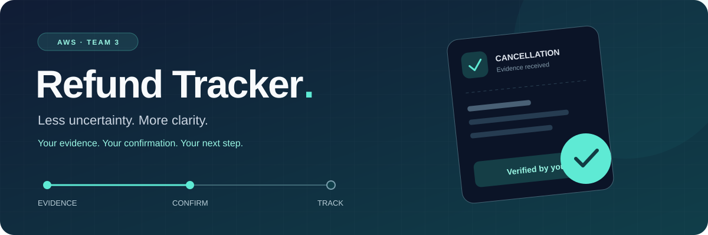
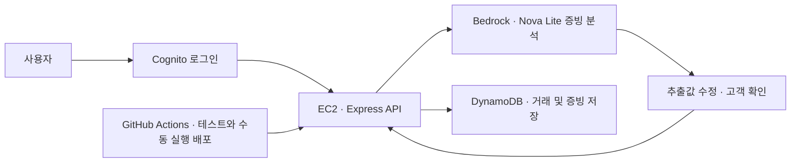
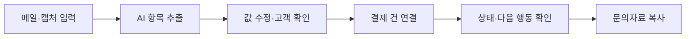

<p align="center">
  
</p>

<h1 align="center">결제 취소·환불 추적 서비스</h1>

<p align="center">
  <strong>취소 이후, 무엇이 확인됐고 무엇을 더 확인해야 할까요?</strong><br />
  취소 증빙과 결제 기록을 연결해 현재 상태와 다음 행동을 안내합니다.
</p>

<p align="center">
  
  
  
  
  
  
</p>

<p align="center">
  <a href="#features">핵심 기능</a> ·
  <a href="#aws">AWS 활용</a> ·
  <a href="#difference">차별점</a> ·
  <a href="#how-it-works">사용 흐름</a> ·
  <a href="#quick-start">실행 방법</a> ·
  <a href="docs/API.md">API 문서</a>
</p>

---

## 해결하려는 문제

쇼핑몰에서 취소 완료 안내를 받았어도 카드 내역에는 결제가 남아 있을 수 있습니다. 고객은 취소 메일과 카드 내역을 따로 열어 주문번호·금액·날짜를 대조하고, 문의할 때 같은 정보를 다시 정리해야 합니다.

**Refund Tracker는 흩어진 증빙을 결제 건별로 모아, 확인된 사실과 추가로 확인할 내용을 구분합니다.** 취소 안내를 받은 뒤 카드 반영 여부를 확인하고 문의자료를 준비하는 과정을 한 화면에서 이어갑니다.

<a id="aws"></a>

## AWS를 활용한 개선

로컬에서 Gemini API와 메모리 저장으로 시작한 서비스를 **EC2에서 실행하고, Bedrock으로 증빙을 분석하며, DynamoDB에 기록을 보관하는 구조**로 확장했습니다. 발표에서는 다음 세 가지 개선에 집중합니다.

| 개선 | 기존 문제 | 적용한 방식 |
| --- | --- | --- |
| **Bedrock AI 증빙 분석** | 로컬 Gemini API 연동에서 AWS 배포 환경의 AI 분석으로 확장 필요 | Amazon Bedrock의 Nova Lite로 취소 메일·PNG/JPEG에서 주문번호·금액·통화·취소일 추출. EC2 IAM 역할로 인증하며, 고객 확인 후에만 증빙 연결 |
| **DynamoDB 영속 저장** | 초기 메모리 저장은 서버를 종료하면 기록 소멸 | SQLite 영속화 단계를 거쳐 DynamoDB에 결제·증빙·타임라인·감사·재전송 결과 저장. 앱 프로세스와 데이터를 분리하고 기존 시연 고객 소유권 이관 |
| **중복 저장 방지** | 응답 유실 후 재시도할 때 최초 처리 결과를 알 수 없음 | 고객별 멱등성 키와 요청 내용 비교. 같은 키·같은 내용은 한 번 저장하고 최초 응답 재현. 같은 키·다른 내용은 거부하고, 같은 결제·취소일의 증빙은 다른 키로 요청해도 중복 방지 |

증빙·이벤트·감사·멱등성 결과는 DynamoDB 트랜잭션 하나로 저장합니다. 중간 단계가 실패하면 일부 기록만 남지 않도록 전체 작업을 취소합니다.



도쿄 리전(`ap-northeast-1`)의 기존 EC2에 [DynamoDB 전환 코드 배포가 성공](https://github.com/chohaeminn/aws-team3/actions/runs/46010186206)했습니다. Bedrock 실제 텍스트·이미지 직접 호출과 앱 텍스트 분석 기록은 [시연 체크리스트](docs/DEMO_CHECKLIST.md)에 있습니다. DynamoDB 저장소·이관 계약 테스트는 로컬에서 **16개 모두 통과**했고 CI에서도 자동 실행합니다. 실제 배포 후 재시작 보존·접근 통제와 앱 이미지 분석의 최종 검증은 [#35](https://github.com/chohaeminn/aws-team3/issues/35)·[#32](https://github.com/chohaeminn/aws-team3/issues/32)·[#33](https://github.com/chohaeminn/aws-team3/issues/33)에 기록합니다.

<a id="features"></a>

## 핵심 기능

| 기능 | 제공하는 정보와 동작 |
| --- | --- |
| AI 증빙 분석 | 취소 메일 텍스트 또는 PNG·JPEG 캡처에서 주문번호·금액·통화·취소일을 추출하고 결제 후보를 제시합니다. |
| 고객 확인 후 연결 | 추출값을 직접 수정하고 내용을 확인한 뒤 결제 건에 연결합니다. 직접 입력도 지원합니다. |
| 출처별 타임라인 | 결제, 취소 요청, 가맹점 취소, 카드 반영 기록을 날짜·출처와 함께 보여줍니다. |
| 상태와 다음 행동 | 가맹점 증빙과 카드 기록을 각각 확인하고, 현재 확보한 자료를 기준으로 다음 확인 사항을 안내합니다. |
| 문의용 요약 복사 | 주문정보, 현재 상태, 증빙·카드 기록, 문의할 내용을 하나의 텍스트로 정리해 복사합니다. |

<a id="difference"></a>

## 차별점

### 취소 안내와 카드 반영을 따로 판단합니다

**가맹점 취소 확인 / 카드 반영 미확인**처럼 출처별 상태를 보여줍니다. 취소 메일만으로 환불 완료를 단정하지 않으며, 카드 기록이 없다는 이유로 미처리라고 판단하지도 않습니다.

### AI가 읽고, 고객이 확인합니다

AI 추출에서 값 수정, 고객 확인, 결제 후보 선택까지 이어집니다. 고객이 확인하기 전에는 추출 결과를 결제 건에 확정 연결하지 않습니다.

### 상태 확인이 문의 준비로 이어집니다

어떤 증빙을 확보했는지와 무엇을 문의해야 하는지 함께 정리합니다. 고객이 메일과 카드 내역을 다시 오가며 문의 내용을 작성하는 부담을 줄이는 것이 목표입니다.

<a id="how-it-works"></a>

## 사용 흐름



예를 들어 취소 메일을 연결했지만 카드 취소 기록이 없는 결제는 다음과 같이 안내합니다.

| 항목 | 표시 내용 |
| --- | --- |
| 현재 상태 | 가맹점 취소 확인 / 카드 반영 미확인 |
| 판단 근거 | 고객이 확인한 취소 증빙이 있으며, 해당 결제의 카드 취소 기록은 없음 |
| 다음 행동 | 확보한 증빙으로 카드사에 취소 반영 여부 문의 |
| 문의자료 | 거래 ID·주문번호·가맹점·금액·결제일·취소일·현재 상태·문의 문구 |

**‘미확인’은 확보한 기록만으로 확인할 수 없다는 뜻입니다.** 실제 처리 결과나 환불 소요 시간을 보장하는 표시는 아닙니다.

## 구현 범위

현재는 **합성 결제 3건의 원화 전액 취소 흐름을 다루는 AWS 시연 서비스**입니다.

| 구분 | 현재 상태 |
| --- | --- |
| 화면·API | 결제 조회, 증빙 입력·수정·확인·연결, 타임라인, 상태 안내, 요약 복사, 시연 초기화 구현 |
| AI 연동 | AWS 시연은 Bedrock Nova Lite 사용. 텍스트·이미지 분석과 실패 시 재시도 구현. 로컬 Gemini 어댑터도 유지 |
| 예시 데이터 | ‘합성 예시 불러오기’로 키 없이 흐름 확인 가능. AI 분석 결과와 구분 |
| 접근 제어 | Cognito access token 검증, 고객별 거래·AI 후보 격리, 관리자 전용 초기화. 고객 A 로그인 및 앱 텍스트 분석 기록 확보 |
| 저장 | AWS에서는 DynamoDB 사용. 로컬 기본값은 SQLite. 증빙·이벤트·멱등성 결과·감사 기록을 트랜잭션으로 저장 |
| 배포·외부 연동 | 도쿄 EC2, S3 배포 아티팩트, SSM 설치·접속, GitHub Actions OIDC 배포. 실제 카드사 미연동 |

API 키 설정 여부와 실제 AI 호출 성공 여부는 구분합니다. 실행 환경에서의 AI 호출·배포 검증 결과는 [시연 체크리스트](docs/DEMO_CHECKLIST.md)에서 관리합니다.

<a id="quick-start"></a>

## 실행 방법

Node.js **22.18 이상인 22.x 또는 24 이상**과 npm이 필요합니다. Node.js 22의 실험적 내장 SQLite API를 사용합니다.

```sh
npm ci
```

다음은 **로컬 Gemini 실행 방법**입니다. AWS Bedrock·DynamoDB 실행은 [AWS 설정 안내](docs/AWS_MANUAL_SETUP.md)와 [DynamoDB 전환 안내](docs/DYNAMODB.md)를 따릅니다. `.env.example`을 `.env`로 복사하고 `GEMINI_API_KEY`를 입력합니다. 서버는 시작할 때 `.env`를 읽습니다. API 키는 Git에 올리지 않습니다.

```dotenv
GEMINI_API_KEY=your_api_key
```

```sh
npm start
```

브라우저에서 [http://localhost:3000](http://localhost:3000)에 접속합니다. 기본 설정에서는 로컬 PC에서만 접속할 수 있습니다.

업무 화면은 로그인이 필요합니다. `.env`에 `COGNITO_USER_POOL_ID`, `COGNITO_CLIENT_ID`, `COGNITO_DOMAIN`을 설정합니다. 값이 없으면 로그인 화면만 제공하고 업무 API는 401로 차단합니다. 로그인 제공자 생성과 합성 거래 소유자 지정은 [AWS 수동 설정](docs/AWS_MANUAL_SETUP.md)을 따릅니다. AWS 없이 코드 검증만 하려면 아래 검사 명령을 실행합니다. 테스트는 로컬 합성 서명 키를 사용합니다.

### 빠르게 확인하기

1. 로그인한 뒤 본인에게 배정된 첫 번째 결제를 선택하고 **합성 예시 불러오기**를 누릅니다.
2. 추출값을 확인·수정한 뒤 확인 체크를 하고 결제에 연결합니다.
3. **가맹점 취소 확인 / 카드 반영 미확인** 상태와 문의용 요약을 확인하고 복사합니다.
4. 두 번째 결제에서 카드 반영 확인 사례를 비교합니다. 관리자는 **시연 초기화**로 처음 상태로 돌아갈 수 있습니다.

로그인과 거래 배정 후에는 AI API 키 없이도 합성 예시 흐름을 확인할 수 있습니다. **AI 분석 버튼은 서버 API를 호출하며 공급자 설정이 없으면 미연결 오류를 반환합니다.**

## 기술 구성

| 영역 | 기술·역할 | 코드 |
| --- | --- | --- |
| 프런트엔드 | React · TypeScript · Vite | [`src/web/`](src/web/) |
| 서버 | Express · TypeScript | [`src/server/`](src/server/) |
| 증빙 분석 | Amazon Bedrock Nova Lite, 로컬 Gemini 어댑터 | [`src/server/evidence/`](src/server/evidence/) |
| 상태·문의자료 | 출처별 상태 계산과 문의용 요약 생성 | [`src/server/status/`](src/server/status/) |
| 결제 저장 | AWS DynamoDB / 로컬 SQLite, 트랜잭션·멱등성·감사 기록 | [`src/server/payments/`](src/server/payments/) |
| 공유 계약 | 클라이언트·서버 공통 타입 | [`src/shared/types.ts`](src/shared/types.ts) |

검증 명령:

```sh
npm run typecheck
npm run build
npm test
```

## 관련 문서

- [API 계약](docs/API.md) — 요청·응답 형식과 오류 처리
- [DynamoDB 저장소](docs/DYNAMODB.md) — 저장소 선택·테이블 설계·로컬 계약 테스트
- [금융권 백엔드 개선 사례](docs/BACKEND_PORTFOLIO.md) — 문제 재현·구현·실측·면접 설명
- [CI와 CD](docs/CI_CD.md) — 자동 검증, 배포 아티팩트, OIDC 수동 배포
- [AWS 수동 설정](docs/AWS_MANUAL_SETUP.md) — AWS에서 직접 진행할 순서
- [AWS 배포·Bedrock 연결](docs/AWS_DEPLOYMENT.md) — 새 계정 인증·배포·팀 접속·삭제 절차
- [시연 체크리스트](docs/DEMO_CHECKLIST.md) — 실제 호출과 시연 검증
- [협업 가이드](CONTRIBUTING.md) — 브랜치·커밋·리뷰 규칙
- [팀 온보딩](docs/TEAM_ONBOARDING.md) — 팀원 작업 시작 안내
