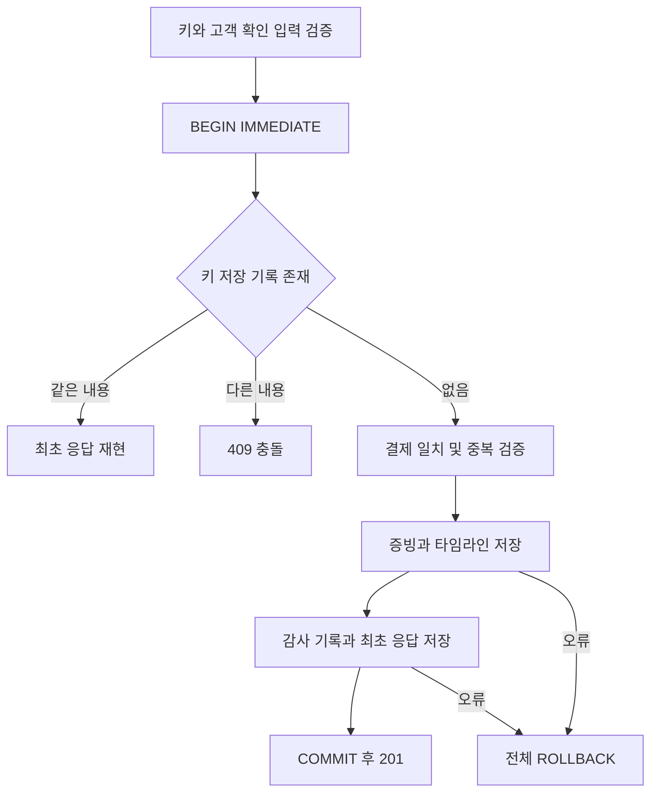

# 환불 추적 백엔드의 재시도와 데이터 보존 개선

취소 증빙을 결제에 연결하는 API에서 응답 유실에 따른 재시도와 서버 재시작을 재현하고, 멱등성·SQLite 트랜잭션·감사 기록을 구현했습니다. 로컬 HTTP 실험에서 동일 요청 재전송의 최초 응답 재현은 0/100건에서 100/100건으로 바뀌었습니다. 이는 증빙 연결 API의 신뢰성 개선 사례이며 실제 결제 승인·환불 실행 시스템은 아닙니다.

## 문제를 발견한 과정

`src/server/app.ts`는 증빙 연결 시 메모리 배열에 증빙과 이벤트를 각각 추가했습니다. 날짜가 같은 증빙이 있으면 409를 반환했지만, 클라이언트의 요청 식별자를 저장하지 않았습니다. 저장을 완료한 뒤 성공 응답이 끊긴 상황에서는 클라이언트가 재시도해도 최초 성공 여부와 결과를 복구할 수 없었습니다.

이를 확인하기 위해 최초 요청을 한 번 성공시킨 뒤 동일 키·본문으로 100개 HTTP 요청을 동시에 보냈습니다. 개선 전에는 100개 모두 중복 오류가 반환됐습니다. 같은 키에서 취소일만 바꾼 요청은 201로 추가 저장됐고, 서버 프로세스를 종료하고 다시 실행하자 최초 증빙 ID가 사라졌습니다.

기존 코드에도 같은 날짜의 중복 저장을 막는 로직은 있었습니다. 따라서 이 개선을 “중복 저장 100건을 0건으로 감소”라고 설명하면 틀립니다. 실측에서 두 구현 모두 동일 본문의 증빙 저장 건수는 1건이었습니다.

## 구현한 변경

1. `Idempotency-Key`와 정규화한 결제 ID·주문번호·금액·통화·취소일의 해시를 저장했습니다. 같은 키·내용은 최초 201 응답 본문을 그대로 재현하며, 내용이 달라지면 `409 IDEMPOTENCY_CONFLICT`로 거부합니다. 키는 평문 대신 SHA-256으로 저장합니다.
2. 결제·증빙·타임라인·멱등성 결과·감사 기록을 SQLite 테이블로 분리했습니다. 증빙에는 `(payment_id, cancelled_on)` 유일 제약과 결제 외래 키를 설정했습니다. 금액은 KRW 양의 안전 정수로 검증합니다.
3. `BEGIN IMMEDIATE` 트랜잭션 안에서 재전송 확인부터 증빙·이벤트·감사·응답 저장까지 처리했습니다. 중간 단계가 실패하면 전체를 롤백합니다. WAL과 `synchronous=FULL`을 설정했습니다.
4. 화면은 증빙 연결 요청에 UUID를 붙입니다. 페이지가 유지되는 동안 네트워크 오류 후 같은 결제·입력으로 다시 시도하면 같은 키를 재사용합니다. 페이지 새로고침까지 클라이언트 키를 보존하는 기능은 아직 없습니다.
5. 서버 실행은 SQLite 파일을 기본으로 사용합니다. AWS에서는 systemd StateDirectory에 파일을 두어 같은 인스턴스의 앱 재시작·재배포에서 보존하도록 배포 설정을 바꿨습니다. 테스트용 `createApp()`은 독립적인 메모리 SQLite를 사용합니다.



구현 위치는 [저장소](../src/server/payments/repository.ts), [API](../src/server/app.ts), [서버 수명 주기](../src/server/index.ts), [신뢰성 테스트](../tests/paymentReliability.test.ts), [실험 스크립트](../scripts/benchmark-reliability.ts)입니다.

## 측정 결과

2026년 11월 27일 13시 34분 KST, Windows 11·Node.js 22.18.0·Intel i7-1165G7에서 실행했습니다. 합성 결제 3건 중 PAY-001을 사용했고, 로컬 HTTP로 최초 성공 1회 후 동시 재전송 100회, 내용 변경 1회, 프로세스 종료와 재시작 1회를 순서대로 수행했습니다. Bedrock과 AWS 네트워크는 포함하지 않았습니다.

| 측정 항목 | 개선 전 | 개선 후 | 해석 |
| --- | --- | --- | --- |
| 재전송 요청의 최초 201 응답 재현 | 0/100건 | 100/100건 | 실험 내 재시도 결과 복구율 0% → 100% |
| 동일 본문 재전송 후 증빙 수 | 1건 | 1건 | 기존 중복 방지 동작 유지 |
| 같은 키에 다른 취소일 전송 | 201 저장 | 409 거부 | 키와 내용의 일치 검증 추가 |
| 프로세스 재시작 후 최초 증빙 ID 보존 | 실패 | 성공 | 동일 디스크 파일에서 1회 검증 |
| 재시작 후 최초 응답 재현 | 실패 | 성공 | 멱등성 결과도 파일에 보존 |
| 재전송 요청 p95 지연 | 158.58 ms | 190.79 ms | 단일 실행 관측값으로 속도 개선을 주장하지 않음 |

원본은 [개선 전 JSON](measurements/reliability-before.json)과 [개선 후 JSON](measurements/reliability-after.json)입니다. 서로 다른 응답 경로인 메모리 오류 반환과 DB 응답 재현을 비교했으므로 위 지연 수치로 저장소 성능의 우열을 판단할 수 없습니다. 전체 서비스 가용성이나 처리 용량을 산출한 실험도 아닙니다.

추가 자동 검증 결과는 다음과 같습니다.

| 검증 | 결과 |
| --- | --- |
| 독립 프로세스 4개에서 공유 DB에 같은 키로 총 100회 연결 | 최초 저장 1회, 같은 응답 100회, 증빙 1건·감사 기록 1건 |
| 이벤트 저장 단계 오류 주입 | 부분 저장 0건, 동일 키 재시도 가능 |
| 감사 기록 저장 단계 오류 주입 | 부분 저장 0건, 동일 키 재시도 가능 |
| 멱등성 결과 저장 단계 오류 주입 | 부분 저장 0건, 동일 키 재시도 가능 |
| 기존 기능과 추가 신뢰성 테스트 | 총 60건 통과 |

오류 주입은 SQLite 트리거로 INSERT를 실패시켰습니다. OS 전원 장애·디스크 손상·트랜잭션 도중 강제 종료를 시험한 결과는 아닙니다.

## 재현 방법

Node.js 22.18 이상인 22.x 또는 24 이상과 npm, Git이 필요합니다.

```sh
npm ci
npm run typecheck
npm run build
npm test
node --import tsx scripts/benchmark-reliability.ts before
npm run benchmark:reliability
```

`before`는 Git 커밋 `544704609a76595b9cef262da0912cb72b9781ff`의 원래 HTTP 핸들러를 임시 경로에서 실행합니다. 작업 트리는 되돌리지 않습니다. `after`는 현재 서버를 별도 프로세스로 실행합니다. 각 실행은 `.qa` 아래 독립 DB를 사용하며 측정 JSON을 갱신합니다. AI 분석은 호출하지 않습니다.

## 포트폴리오에 쓸 설명

> 취소 증빙 연결 API에서 저장 후 응답 유실을 가정한 재시도 시나리오를 재현했습니다. 기존 API는 같은 요청을 다시 보내면 중복 오류를 반환하고, 프로세스 재시작 시 연결 정보가 소멸했습니다. 요청 키와 본문 해시를 저장하고 증빙·이벤트·감사 기록·최초 응답을 하나의 DB 트랜잭션으로 묶었습니다. 로컬 HTTP 동시 재전송 100건에서 최초 응답 재현을 0건에서 100건으로 개선했고, 독립 프로세스 4개의 총 100회 요청에서도 저장은 1회만 발생했습니다. 저장 단계 3곳의 오류 주입 테스트에서 부분 저장 0건을 확인했습니다.

면접에서는 “멱등성은 요청 재시도의 결과를 복구하고, 유일 제약은 서로 다른 키로 들어온 업무 중복을 막는다”는 역할 구분을 설명할 수 있습니다. DB를 선택한 이유는 새 외부 서비스를 추가하지 않고 단일 호스트에서 트랜잭션과 재시작 보존을 검증하기 위해서입니다. 다중 호스트 확장에서는 PostgreSQL 같은 외부 DB로 저장소 구현을 교체하고 동일한 테스트를 다시 통과시켜야 합니다.

## 다음 개선 우선순위

아래는 후속 작업과 측정 계획입니다. 아직 달성한 수치가 아닙니다.

| 우선순위 | 현재 남은 문제 | 구현 방향 | 완료를 판단할 근거 |
| --- | --- | --- | --- |
| 1 | 사용자 인증과 거래 소유권 검사가 없고 초기화 API를 호출할 수 있음 | 인증, 고객별 거래 격리, 관리자 전용 초기화 | 다른 고객의 ID로 조회·연결을 시도하는 권한 테스트와 거부율 |
| 2 | 같은 호스트의 동기식 SQLite와 전체 목록 조회에 의존 | PostgreSQL 이전, 페이지네이션, 실행 계획 기반 인덱스 | 데이터 1만·10만 건, 동시성 10·50·100에서 p50/p95·오류율·DB CPU 비교 |
| 3 | 실제 카드사 취소 통지와 내부 증빙의 대사 기능이 없음 | 합성 webhook 수신, 이벤트 ID 중복 방지, 순서 역전 처리와 불일치 목록 | 중복·누락·지연·순서 역전 fixture에서 최종 상태 일치율과 복구 시간 |
| 4 | AI 추출 정확도와 비용을 평가할 정답 데이터셋이 없음 | 합성 증빙 정답 세트와 모델별 평가 스크립트 | 주문번호·금액·통화·날짜별 일치율, 오류 유형, 건당 토큰·비용·지연 |

실제 금융권 운영 수준에는 고객별 권한, 민감정보 보호, 변경 불가능한 외부 감사 보관, 백업 복구, 스키마 마이그레이션, 관측 지표가 추가로 필요합니다. 현재 감사 테이블은 인증된 행위자를 기록하지 않으며 DB 관리자에 의한 변경을 막지 않습니다. 멱등성 기록의 보존 기간·정리 정책도 후속 과제입니다. 이 상태의 서비스는 접근을 제한한 합성 데이터 시연 범위로 사용합니다.

SQLite 호출은 동기식이고 Node.js 22에서는 실험적 API입니다. [Node.js 공식 SQLite 문서](https://nodejs.org/download/release/v22.19.0/docs/api/sqlite.html)에서 API 특성과 지원 버전을 확인할 수 있습니다.
